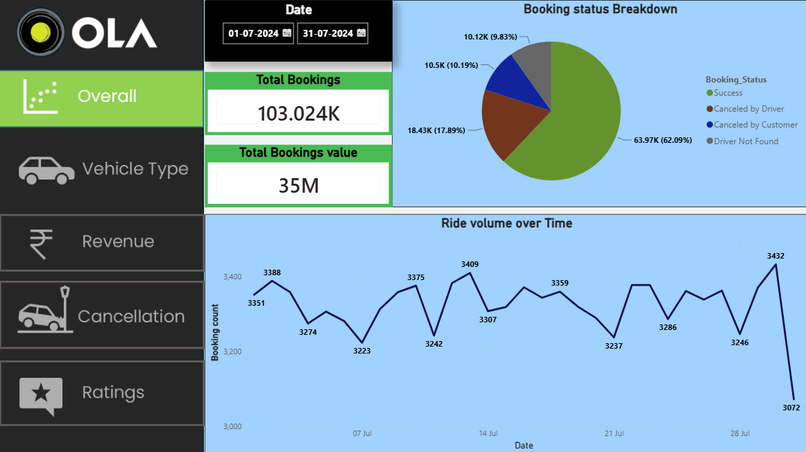
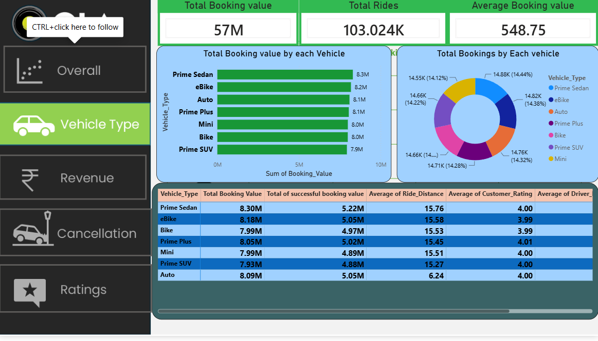
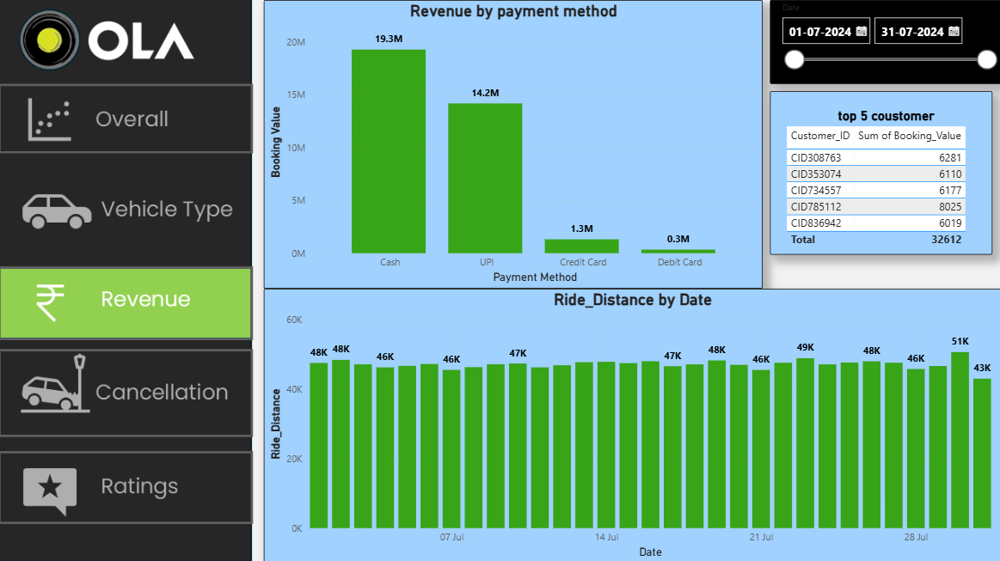
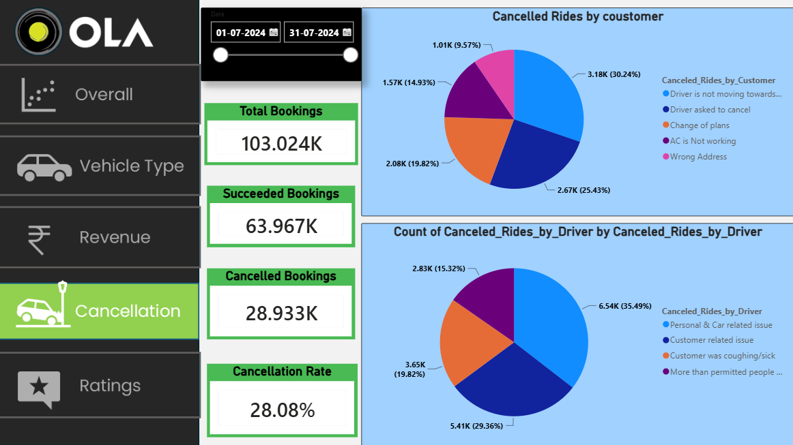
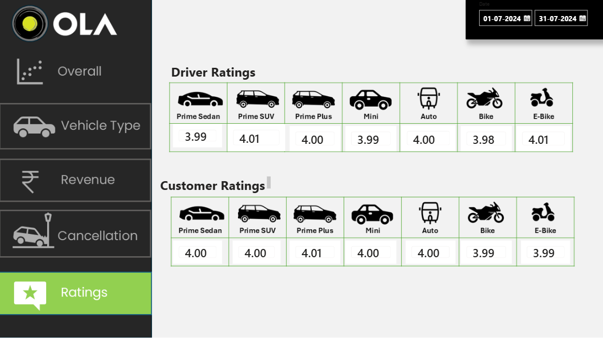

# Ola Ride Booking Analysis — SQL & Power BI

An end-to-end **ride-booking data analytics project** exploring more than **100,000 Ola booking records** to understand booking performance, cancellations, revenue, ride distances, and customer experience.

The project follows a practical analytics workflow: **prepare the dataset in Excel, answer business questions using SQL, and communicate findings through an interactive Power BI dashboard.** Its goal is to turn raw operational data into insights that can support mobility-service decisions.

> **Project scope:** An independent portfolio analysis of an Ola-themed ride-booking dataset. It is not affiliated with or endorsed by Ola, and the dataset should not be interpreted as official company data.



---

## Features

- **Booking performance analysis** — examine successful, cancelled, and incomplete rides and how booking volume changes over time.
- **Cancellation analysis** — separate customer-initiated and driver-initiated cancellations and explore recorded reasons.
- **Revenue and payments** — analyze booking value, successful-ride value, and the distribution of payment methods.
- **Vehicle-type insights** — compare booking activity, ride distance, and ratings across vehicle categories.
- **Customer analysis** — identify frequent riders and customers contributing the highest booking value.
- **Service-quality monitoring** — compare customer and driver ratings to examine differences in ride experience.
- **Interactive reporting** — use Power BI report pages and filters to investigate operational and financial trends.

---

## Tech Stack

| Tool | Role |
| --- | --- |
| **Microsoft Excel** | Dataset inspection, cleaning, and preparation |
| **SQL** | Querying booking records and answering business questions |
| **Power BI** | Data modeling, KPI reporting, and interactive visualizations |

## Dataset

| Attribute | Details |
| --- | --- |
| **Size** | 100,000+ booking records |
| **Domain** | Transportation / ride-hailing |
| **Unit of analysis** | Individual ride booking |
| **Source file** | `ola cleaned dataset.xlsx` |

The analysis covers booking status, vehicle types, ride distances, booking values, payment methods, cancellation information, and customer/driver ratings.

**Data note:** The repository includes a cleaned dataset. The original dataset source and collection method have not been specified here; do not treat these records as verified internal Ola transactions.

---

## Project Workflow

1. **Data preparation — Excel:** Review the booking data, address quality and consistency issues, and prepare a cleaned spreadsheet for analysis.
2. **Business analysis — SQL:** Query the cleaned records to calculate operational metrics, examine cancellation patterns, and identify high-value customers.
3. **Data visualization — Power BI:** Build an interactive report with high-level KPIs and focused views of booking trends, vehicle performance, revenue, cancellations, and ratings.
4. **Business interpretation:** Translate dashboard patterns into questions and observations relevant to service reliability, customer experience, and revenue performance.

```text
Raw booking data
       |
       v
Excel — cleaning & preparation
       |
       +------------------------+
       |                        |
       v                        v
SQL — business queries    Power BI — dashboard
       |                        |
       +------------+-----------+
                    |
                    v
          Operational insights
```

---

## SQL Analysis

The SQL script, [`ola project codes sql.sql`](ola%20project%20codes%20sql.sql), addresses ten business questions:

| # | Business question | Analytical focus |
| --- | --- | --- |
| 1 | Which bookings were successful? | Completion / booking status |
| 2 | What is the average ride distance by vehicle type? | Vehicle utilization |
| 3 | How many rides were cancelled by customers? | Customer cancellations |
| 4 | Who are the top five customers by number of bookings? | Booking frequency |
| 5 | How many driver cancellations were due to personal or vehicle-related issues? | Driver-side reliability |
| 6 | What are the minimum and maximum driver ratings for Prime Sedan bookings? | Service quality |
| 7 | Which rides were paid for through UPI? | Payment behavior |
| 8 | What is the average customer rating for each vehicle type? | Customer satisfaction |
| 9 | What is the total booking value of successful rides? | Revenue-related KPI |
| 10 | Which rides were incomplete, and what reasons were recorded? | Unfulfilled demand |

These queries provide a repeatable starting point for investigating the booking lifecycle and comparing performance across ride categories.

---

## Power BI Dashboard

The Power BI report, [`ola booking analysis.pbix`](ola%20booking%20analysis.pbix), brings the analysis together in a visual, interactive format.

### 1. Overview — Booking Trends & KPIs

View overall booking activity, headline KPIs, booking-status composition, and time-based patterns.


### 2. Vehicle Performance

Compare vehicle categories, ride distances, and performance indicators to understand how demand varies by vehicle type.



### 3. Revenue Analysis

Investigate booking value and revenue-related trends, including differences across payment methods.



### 4. Cancellation Analysis

Examine ride cancellations and recorded reasons to identify areas for operational investigation.



### 5. Ratings & Customer Experience

Compare customer and driver ratings to assess service-quality patterns across bookings.



**Dashboard topics covered:** ride volume over time, booking status, vehicle-type ride distance, ratings by vehicle type, cancellation reasons, payment-method revenue, high-value customers, and ride-distance and rating distributions.

---

## Insights & Business Applications

The project is designed to help answer practical mobility-business questions:

- **Demand:** Which vehicle types are booked most frequently, and how does demand shift over time?
- **Reliability:** What share of bookings are successful versus cancelled or incomplete, and what reasons are reported?
- **Revenue:** Which payment methods and customer groups account for the largest booking values?
- **Experience:** Do ratings vary by vehicle type, and do customer and driver assessments show different patterns?
- **Operations:** Which cancellation categories or ride segments warrant closer investigation?

These are **analytical themes, not quantified findings**. Exact percentages, rankings, and conclusions should be taken from the SQL results or dashboard rather than assumed from the project description.

---

## Project Structure

```text
ola-ride-booking-analysis/
|
|-- ola booking analysis.pbix      # Interactive Power BI report
|-- ola cleaned dataset.xlsx      # Prepared booking dataset
|-- ola project codes sql.sql     # SQL business-analysis queries
|-- README.md                     # Project documentation
|-- Screenshot.png                # Dashboard preview — overview
|-- Screenshot1.png               # Dashboard preview — vehicle performance
|-- Screenshot2.png               # Dashboard preview — revenue
|-- Screenshot3.png               # Dashboard preview — cancellations
`-- Screenshot4.png               # Dashboard preview — ratings
```

## Getting Started

### 1. Get the project files

Download the repository as a ZIP from GitHub or clone it using its repository URL:

```bash
git clone <YOUR-REPOSITORY-URL>
cd <YOUR-REPOSITORY-FOLDER>
```

### 2. Explore the dataset

Open `ola cleaned dataset.xlsx` in Excel to review the prepared booking records and column names.

### 3. Run the SQL analysis

Open `ola project codes sql.sql` in a compatible SQL editor. Import the dataset into your database, then review the SQL script for its expected **table names, column names, and SQL dialect** before running the queries. The exact database platform and import steps depend on your environment.

### 4. Explore the Power BI report

1. Install **Power BI Desktop** on Windows.
2. Open `ola booking analysis.pbix`.
3. If the dataset connection is broken, update the source path to the local copy of `ola cleaned dataset.xlsx` under **Transform data → Data source settings** (or the applicable Power Query source step).
4. Refresh the report and explore the dashboard pages and filters.

> The `.pbix` file is the interactive report. The `Screenshot*.png` files are static previews that can be viewed directly on GitHub.

---

## Learning Outcomes

- Practiced an end-to-end analysis workflow across **Excel, SQL, and Power BI**.
- Framed operational questions as SQL queries over structured booking records.
- Analyzed booking success, cancellations, ride distances, payment methods, and ratings.
- Presented related metrics in a multi-page dashboard for easier exploration.
- Connected technical analysis with business questions about reliability, demand, revenue, and customer satisfaction.

---

## Future Improvements

- Introduce reproducible cleaning scripts and data-quality checks.
- Add a data dictionary describing each field and its business meaning.
- Track cancellation and completion rates by time period and vehicle category.
- Add cohort or repeat-customer analysis when reliable customer identifiers are available.
- Explore demand forecasting or cancellation-risk models if the dataset supports them.
- Record validated KPI values and specific recommendations in an insights summary.

---

**Built as a data analytics portfolio project using Excel, SQL, and Power BI.**
